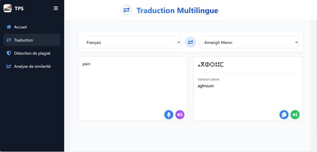
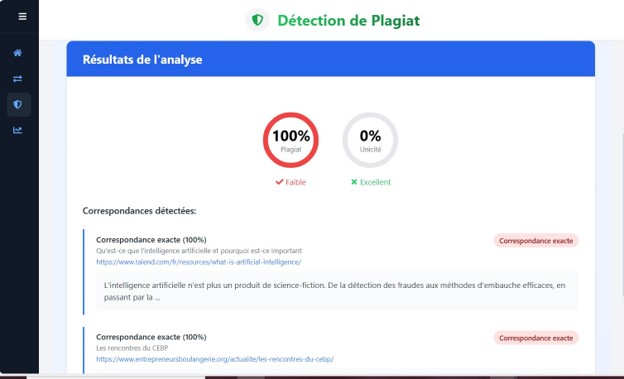
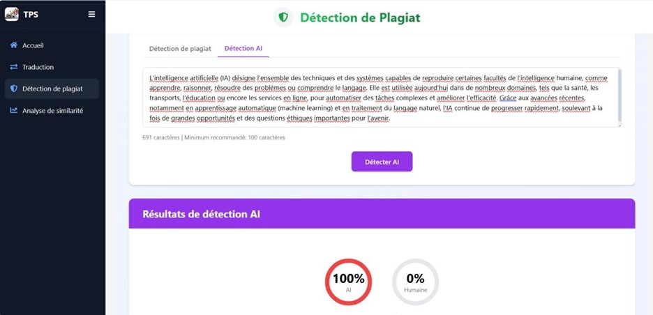
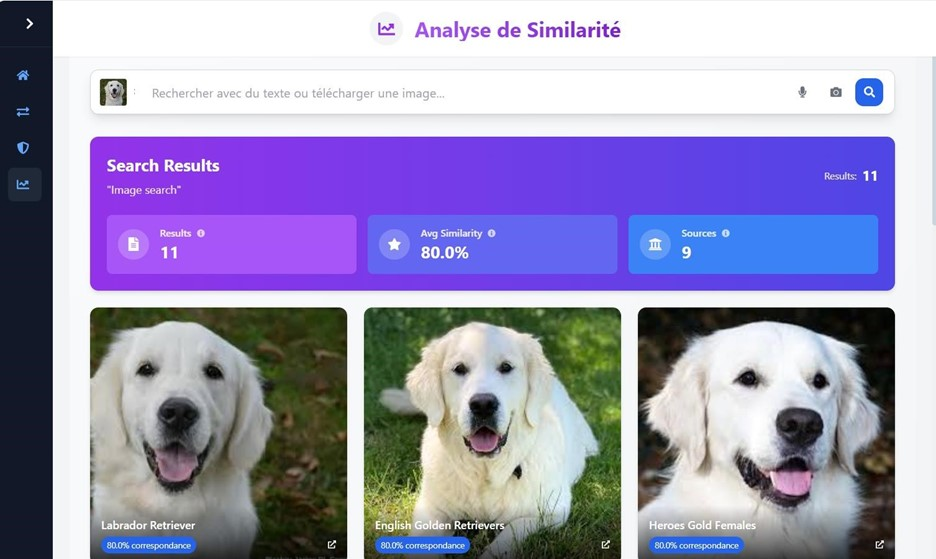

# 🚀 TPS: Integrating AI Tools with Elasticsearch for Academia & Research

An intelligent, modular web platform combining **Artificial Intelligence**, **Natural Language Processing (NLP)**, **Computer Vision**, and **Vector Search** to assist students, educators, and researchers[cite: 56, 64, 65].

---

## ✨ Key Features

* **🌐 Contextual Multilingual Translation:**
  * Instant translation across French, English, Arabic, and Amazigh[cite: 69, 97, 98].
  * Supports manual text input, voice recognition (Speech-to-Text), and audio playback (Text-to-Speech)[cite: 69, 98].

* **🛡️ Plagiarism & AI-Generated Content Detection:**
  * Originality verification cross-referencing a local scientific database (**MongoDB**) and web sources (**Google API**)[cite: 69, 80].
  * Dedicated module for detecting AI-generated text (**ZeroGPT / OpenAI API**) with detailed uniqueness and similarity scores[cite: 80, 101].

* **🔍 Multimodal Similarity Analysis:**
  * Intelligent retrieval of visually or semantically similar resources via **image**, **text description**, or **voice query**[cite: 64, 103].
  * Powered by **CLIP** (Contrastive Language-Image Pretraining) vector embeddings indexed in **Elasticsearch** (k-NN search)[cite: 63, 86].

---

## 🏗️ Architecture & Tech Stack

The application is built on a three-tier client-server architecture coupling the flexible NoSQL document storage of **MongoDB** with the distributed indexing power of **Elasticsearch**[cite: 84, 86, 93, 94].

### Indexing Architecture & Data Flow


### Technologies Used
* **Frontend:** React.js, HTML5, CSS3, JavaScript[cite: 70, 71, 93]
* **Backend:** Python, Flask (REST API)[cite: 71, 92, 93]
* **Databases & Search Engine:** Elasticsearch (Full-Text & Vector Search), MongoDB (NoSQL)[cite: 84, 86]
* **AI Models & APIs:** OpenAI CLIP, OpenAI API (ChatGPT-4), ZeroGPT API, Google Search API[cite: 86]
* **Modeling & Project Management:** UML (Use Case, Sequence, and Class Diagrams), V-Model Lifecycle, MS Project[cite: 73, 77, 78, 79, 82]

---

## 📸 Interface Preview (Demo)

### 1. Home Page & Navigation


### 2. Multilingual Translation Module (with Amazigh & Audio Support)


### 3. Plagiarism Detection


### 4. AI Content Detection


### 5. Multimodal Similarity Search (CLIP)


---

## ⚙️ Local Installation & Setup

### Prerequisites
* Python 3.9+
* Node.js & npm
* MongoDB and Elasticsearch installed and running locally

### 1. Clone the Repository
```bash
git clone [https://github.com/monsef-elouardy/ai-powered-academic-research.git](https://github.com/monsef-elouardy/ai-powered-academic-research.git)
cd ai-powered-academic-research
```

### 2. Backend Setup (Flask)

1. Navigate to the server directory and activate the virtual environment:
```bash
cd server
python -m venv venv
source venv/bin/activate  # On Windows: venv\Scripts\activate
pip install -r requirements.txt
```

2. Create a `.env` file in the root of the `server` directory and add your API keys:
```env
OPENAI_API_KEY=your_openai_api_key
GOOGLE_API_KEY=your_google_api_key
ZEROGPT_API_KEY=your_zerogpt_api_key
MONGO_URI=mongodb://localhost:27017/
ELASTICSEARCH_HOST=http://localhost:9200
```

3. Start the backend server:
```bash
python app.py
```

### 3. Frontend Setup (React)
In a separate terminal:
```bash
cd client
npm install
npm start
```
The application will be accessible at: `http://localhost:3000`.

---

## 👥 Authors & Supervision

* **Developed by:** El Ouardy Monsef & El Ayadi Oualid[cite: 56]
* **Supervised by:** Prof. Noura Aherrahrou[cite: 56]
* **Degree:** Bachelor's in Mathematical and Computer Sciences (SMI) – Final Year Project (2024/2025)[cite: 56]
* **Institution:** Faculty of Sciences Dhar El Mahraz – Sidi Mohamed Ben Abdellah University, Fez, Morocco[cite: 56]
