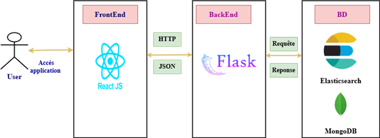
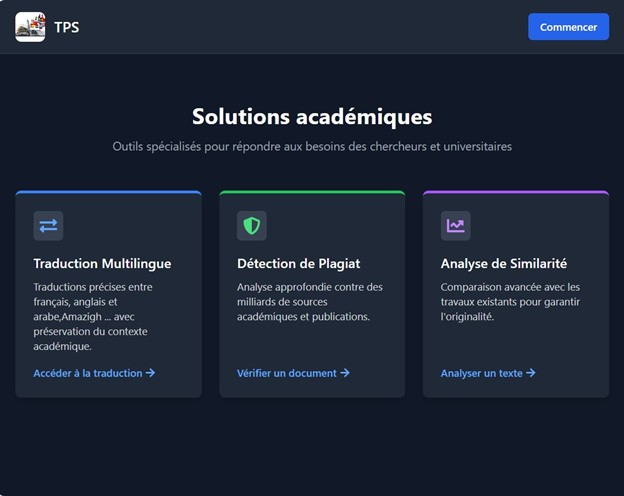

# 🚀 TPS : Integrating AI Tools with Elasticsearch for Academia & Research

Plateforme web modulaire intelligente combinant **Intelligence Artificielle**, **Traitement Automatique du Langage (NLP)**, **Vision par Ordinateur** et **Recherche Vectorielle** pour accompagner les étudiants, enseignants et chercheurs[cite: 56, 64, 65].

---

## ✨ Fonctionnalités Principales

* **🌐 Traduction Multilingue Contextuelle :**
  * Traduction instantanée entre le Français, l'Anglais, l'Arabe et l'Amazigh[cite: 69, 97, 98].
  * Saisie manuelle ou par reconnaissance vocale (Speech-to-Text) et lecture par synthèse vocale (Text-to-Speech)[cite: 69, 98].

* **🛡️ Détection de Plagiat & Contenu Généré par IA :**
  * Vérification d'originalité croisant une base scientifique locale (**MongoDB**) et les sources web (**Google API**)[cite: 69, 80].
  * Module dédié à la détection de textes générés par IA (**ZeroGPT / OpenAI API**) avec calcul des scores d'unicité et de similarité[cite: 80, 101].

* **🔍 Analyse de Similarité Multimodale :**
  * Recherche intelligente de ressources visuelles similaires par **image**, **description textuelle** ou **requête vocale**[cite: 64, 103].
  * Basée sur les embeddings vectoriels du modèle **CLIP** (Contrastive Language-Image Pretraining) indexés dans **Elasticsearch** (recherche k-NN)[cite: 63, 86].

---

## 🏗️ Architecture & Stack Technique

L'application repose sur une architecture client-serveur à trois niveaux couplant le stockage flexible NoSQL de **MongoDB** à la puissance d'indexation distribuée d'**Elasticsearch**[cite: 84, 86, 93, 94].

### Architecture d'Indexation & Flux de Données


### Technologies Utilisées
* **Frontend :** React.js, HTML5, CSS3, JavaScript[cite: 70, 71, 93]
* **Backend :** Python, Flask (API REST)[cite: 71, 92, 93]
* **Bases de données & Recherche :** Elasticsearch (Full-Text & Vector Search), MongoDB (NoSQL)[cite: 84, 86]
* **Modèles & APIs IA :** OpenAI CLIP, OpenAI API (ChatGPT-4), ZeroGPT API, Google Search API[cite: 86]
* **Modélisation & Gestion :** UML (Cas d'utilisation, Séquence, Classes), Cycle en V, MS Project[cite: 73, 77, 78, 79, 82]

---

## 📸 Aperçu des Interfaces (Démonstration)

### 1. Page d'Accueil & Navigation


### 2. Module de Traduction Multilingue (avec support Amazigh & Audio)


### 3. Détection de Plagiat


### 4. Analyse IA


### 5. Recherche de Similarité Multimodale (CLIP)


---

## ⚙️ Installation & Lancement en local

### Prérequis
* Python 3.9+
* Node.js & npm
* MongoDB et Elasticsearch installés et démarrés localement

### 1. Cloner le dépôt
```bash
git clone https://github.com/monsef-elouardy/ai-powered-academic-research.git
cd ai-powered-academic-research
```

### 2. Configuration du Backend (Flask)

1. Accédez au dossier serveur et activez l'environnement virtuel :
```bash
cd server
python -m venv venv
source venv/bin/activate  # Sur Windows : venv\Scripts\activate
pip install -r requirements.txt
```

2. Créez un fichier `.env` à la racine du dossier `server` et ajoutez vos clés API :
```env
OPENAI_API_KEY=votre_cle_openai
GOOGLE_API_KEY=votre_cle_google
ZEROGPT_API_KEY=votre_cle_zerogpt
MONGO_URI=mongodb://localhost:27017/
ELASTICSEARCH_HOST=http://localhost:9200
```

3. Démarrez le serveur backend :
```bash
python app.py
```

### 3. Configuration du Frontend (React)
Dans un second terminal :
```bash
cd client
npm install
npm start
```
L'application sera accessible à l'adresse : `http://localhost:3000`.

---

## 👥 Auteurs & Encadrement

* **Réalisé par :** El Ouardy Monsef & El Ayadi Oualid[cite: 56]
* **Encadrante :** Pr. Noura Aherrahrou[cite: 56]
* **Formation :** Licence en Sciences Mathématiques et Informatiques (SMI) – Projet de Fin d'Études (2024/2025)[cite: 56]
* **Établissement :** Faculté des Sciences Dhar El Mahraz – Université Sidi Mohamed Ben Abdellah, Fès[cite: 56]
